  

  Passionate about Artificial Intelligence, Machine Learning, and building real-world projects.

---

## 🚀 About Me

  

- 🎓 B.E. Student at Mohamed Sathak A.J. College of Engineering (Chennai, India)
- 💻 Focused on Artificial Intelligence, Machine Learning & Deep Learning
- 🌱 Building full-stack apps with Python, Flutter, and Firebase
- 🛠️ Working with Python, HTML, CSS, JavaScript, Java, MySQL, Git, GitHub, and Visual Studio Code
- 🤖 Interested in AI-powered applications, chatbots, and practical software development
- 📦 Experienced with CRUD applications, data structures, and menu-driven Python tools
- 🎯 Goal: Become an AI/ML Engineer
---

## 💻 Technical Skills

  

---

## 📂 My Projects

- 🌱 **Plant Classification**
- 🎓 **EduChain – Digital Micro-Scholarship Platform**
- 🤖 **AI & ML Projects**
- 🚌 **BusBee – Smart Routes**
- 💻 **Multi-Student Management System**
- 📚 **Student Dashboard**
- 🪪 **Student Registration System**

---

## 📊 GitHub Statistics

  

  

---

## 🌐 Connect With Me

- LinkedIn: [Mohamed Hashim](https://www.linkedin.com/in/mohamed-hashim-836a64327)
- GitHub: [mohamedhashim17](https://github.com/mohamedhashim17)

---

<h3 align="center">Thanks for visiting my profile! 😊</h3>
